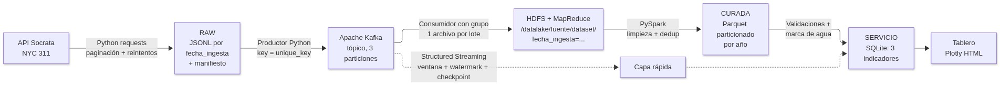
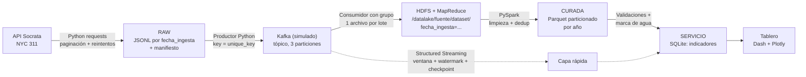

# Pipeline de datos masivos: solicitudes ciudadanas 311 de Nueva York

Proyecto final de datos masivos. Es un pipeline de punta a punta con arquitectura **lambda**: descarga solicitudes del servicio 311 de Nueva York, las pasa por una zona raw, mensajería, un data lake en HDFS, una zona curada con PySpark y una zona de servicio en SQLite. Termina en un tablero interactivo hecho con Dash.

## Pregunta

> **¿Cuáles son los principales problemas urbanos reportados por los ciudadanos de Nueva York y cómo varían los tiempos de atención y resolución según el tipo de problema, la agencia responsable y la ubicación?**

Usuarios de los indicadores: ciudadanos, investigadores de gestión urbana, administradores públicos y analistas de servicios ciudadanos.

**Respuesta (ejecución del 2026-11-24, 49.944 solicitudes del 2026-10-25 al 2026-11-23 12:06):**

Illegal Parking, Noise - Residential y HEAT/HOT WATER concentran el 42,2% de las quejas en Nueva York; resolverlas toma desde 1,2 h (Noise - Residential) hasta 42,3 h (HEAT/HOT WATER).

* **Principales problemas:** Los más reportados son Illegal Parking (18,0%), Noise - Residential (15,6%) y HEAT/HOT WATER (8,6%): juntos suman el 42,2% de las 49.944 solicitudes. Les siguen Noise - Street/Sidewalk y Blocked Driveway.
* **Según el tipo de problema:** Entre los 10 problemas más frecuentes, Noise - Commercial es el que se cierra más rápido (mediana de 0,9 h) y UNSANITARY CONDITION el que más tarda (6,3 días).
* **Según la agencia:** NYPD (New York City Police Department) atiende el 54,0% de las solicitudes y las cierra en una mediana de 1,3 h. La más lenta es DOHMH (Department of Health and Mental Hygiene), con 3,1 días.
* **Según la ubicación:** BROOKLYN es el distrito con más solicitudes (34,0%). La mediana de resolución va de 2,0 h en BROOKLYN a 3,8 h en BRONX.
* **Atención en general:** El 84,4% de las solicitudes ya está cerrado y la mediana hasta el cierre es de 2,6 h.

**Conclusión:** El tiempo de atención depende mucho más de la agencia y del tipo de problema que de la ubicación: entre agencias la mediana va de 0,0 h a 3,1 días, mientras que entre distritos solo va de 2,0 h a 3,8 h.

El tablero muestra esta misma respuesta en la sección *Respuesta a la pregunta*; los textos los genera el pipeline (tabla `ind_respuesta`).

## Fuente

* **Dataset:** [311 Service Requests from 2020 to Present](https://data.cityofnewyork.us/Social-Services/311-Service-Requests-from-2020-to-Present/erm2-nwe9) (NYC Open Data, id `erm2-nwe9`), con unos 23 millones de registros y 44 columnas.
* **Acceso:** API Socrata (`https://data.cityofnewyork.us/resource/erm2-nwe9.json`), sin credenciales.
* **Muestra:** los últimos 30 días con datos publicados, 1.666 solicitudes por día (≈ 50.000).
* **Fecha de corte:** la fecha de la solicitud más reciente de la muestra. Aparece en el tablero y en la tabla `ind_metadatos`.

## Diagrama





| Zona | Qué contiene | Dónde |
|---|---|---|
| Raw | Cada registro de la API dentro de un "sobre" JSON (`fuente`, `dataset`, `id_registro`, `fecha_ingesta`, `payload` intacto) y un `manifiesto.json` | `raw/fecha_ingesta=AAAA-MM-DD/` |
| Mensajería | Tópico `nyc-311-raw` con 3 particiones; la llave es `unique_key` | En memoria (simulador) |
| Data lake | Un archivo JSONL por lote de consumo | HDFS: `/datalake/socrata_api_nyc/erm2-nwe9/fecha_ingesta=.../` |
| Curada | Datos deduplicados, tipados y limpios en Parquet particionado por año | `%USERPROFILE%\bigdata\curada_parquet` |
| Servicio | Tabla validada `solicitudes_311`, ventanas de streaming e indicadores listos para el tablero | `servicio_nyc311.db` (SQLite) |

## Estructura del repositorio

```
├── Final_Datos_Masivos.ipynb   # Pipeline completo (partes 1 a 8), ejecutado con sus salidas
├── dashboard/
│   ├── app.py                  # Tablero Dash: solo lee las tablas ind_* de SQLite
│   └── assets/estilo.css
├── servicio_nyc311.db          # Zona de servicio generada por el pipeline
├── evidencias/                 # Evidencias de HDFS, MapReduce vs Spark, calidad y marca de agua
├── diagrama_pipeline.png
├── requirements.txt            # Dependencias del pipeline completo
├── index.py                    # Entrada del tablero para Vercel
├── pyproject.toml              # Dependencias del tablero (despliegue en Vercel)
└── .vercelignore               # Lo que no se sube a Vercel
```

La carpeta `raw/` (≈ 80 MB) no se sube al repositorio porque el cuaderno la regenera.

## Cómo ejecutar el pipeline paso a paso

### Requisitos

* Windows 10 u 11 de 64 bits. El pipeline corre de forma nativa, sin WSL ni Docker.
* Python **3.12** (PySpark 3.5.1 no funciona con Python 3.13 o 3.14).
* Conexión a internet. La primera ejecución descarga Java 11 portátil (≈ 190 MB) y Hadoop 3.3.6 (≈ 700 MB).
* Unos 3 GB libres en disco y 8 GB de RAM.

No hace falta instalar Java ni Hadoop a mano: el propio cuaderno los descarga en `%USERPROFILE%\bigdata`, sin permisos de administrador.

### 1. Clonar y preparar el entorno

```powershell
git clone https://github.com/THEKALAHAN/proyecto-final-pipeline-datos.git
cd proyecto-final-pipeline-datos
py -3.12 -m venv .venv
.venv\Scripts\python -m pip install -r requirements.txt
.venv\Scripts\python -m ipykernel install --user --name pipeline-datos --display-name "Python 3.12 (pipeline-datos)"
```

### 2. Ejecutar el cuaderno

Abre `Final_Datos_Masivos.ipynb` en VS Code o Jupyter, elige el kernel **"Python 3.12 (pipeline-datos)"** y ejecuta todas las celdas (*Run All*). La primera vez tarda unos 15 minutos, casi todo en descargas.

| Parte | Qué hace |
|---|---|
| Inicio | Carga las librerías, configura las rutas de Windows y genera el diagrama |
| Ingesta raw | Descarga 30 días de la API (paginación y reintentos), escribe el JSONL y el manifiesto |
| 3. Kafka | Publica cada sobre en un tópico de 3 particiones y consume una muestra por partición |
| 4. HDFS y MapReduce | Instala Java y Hadoop, levanta el NameNode y el DataNode, guarda los lotes en HDFS, cuenta quejas por tipo con MapReduce (Hadoop Streaming) y compara el resultado con Spark |
| 5. Zona curada | PySpark deduplica por `id_registro`, corrige tipos y nulos y escribe Parquet particionado por año |
| 6. Calidad e incremental | Aplica las validaciones, la marca de agua y el upsert idempotente en SQLite |
| 7. Capa rápida | Spark Structured Streaming con ventanas de 15 minutos, marca de agua de 1 hora y checkpoint; demuestra un reinicio sin duplicados |
| 8. Zona de servicio | Calcula los indicadores y los guarda como tablas `ind_*` |
| Cierre | Detiene Spark y HDFS |

Para comprobar la ejecución completa desde una terminal, sin abrir el editor:

```powershell
.venv\Scripts\python -m pip install nbclient
.venv\Scripts\jupyter execute Final_Datos_Masivos.ipynb --kernel_name=pipeline-datos
```

### 3. Abrir el tablero

```powershell
.venv\Scripts\python dashboard\app.py
```

Luego entra a <http://127.0.0.1:8050>. El tablero solo lee `servicio_nyc311.db`: no necesita HDFS ni Spark encendidos, y como el repositorio incluye la base ya generada, puede abrirse sin ejecutar el pipeline.

### 4. Publicar el tablero en internet (Vercel)

El repositorio ya está preparado para Vercel:

| Archivo | Para qué sirve |
|---|---|
| `index.py` | Punto de entrada: expone el servidor Flask del tablero como `app`, que es lo que busca Vercel |
| `pyproject.toml` | Solo las dependencias del tablero (Flask, Dash, Plotly y pandas) |
| `.vercelignore` | Deja fuera del despliegue el `requirements.txt` del pipeline (PySpark pesa ≈ 300 MB), el cuaderno y las evidencias |

Para publicarlo: entra a [vercel.com](https://vercel.com) con tu cuenta de GitHub, elige *Add New → Project*, importa este repositorio y pulsa *Deploy* sin cambiar la configuración. Cada push a `main` vuelve a publicarlo.

En Vercel el tablero carga las librerías JavaScript (React, Plotly) desde el CDN de unpkg, porque una función de Vercel no puede responder más de 4,5 MB y `plotly.min.js` pesa casi 5 MB. En local las sigue sirviendo el propio tablero. La base SQLite viaja con el despliegue y solo se lee.

## Zona de servicio e indicadores

El pipeline calcula los indicadores (Parte 8) y el tablero solo hace `SELECT`, sin agregaciones.

| Tabla | Responde | Visualización en el tablero |
|---|---|---|
| `ind_problemas_principales` | ¿Cuáles son los principales problemas? | 1. Barras con el top 10; los 3 primeros destacados |
| `ind_tiempo_por_agencia` | ¿Cómo varía el tiempo según la agencia? | 2. Barras de mediana o percentil 90 de horas hasta el cierre |
| `ind_distrito_problema` | ¿Cómo varía según la ubicación? | 3. Mapa de calor distrito × problema (solicitudes, mediana o % cerradas) |
| `ind_distritos` | Resumen por ubicación | Tabla resumen |
| `ind_capa_rapida` | Capa rápida (lambda) | Línea de solicitudes por ventana de 15 minutos |
| `ind_pipeline` | Trazabilidad | Pestaña "Cómo se construyó": evidencias de cada etapa |
| `ind_metadatos` | Título, fuente y fecha de corte | Encabezado, cifras clave y pie de página |
| `ind_respuesta` | La respuesta a la pregunta, por dimensión | Sección "Respuesta a la pregunta" bajo las cifras clave |

Cada gráfico tiene su tabla de datos equivalente ("Ver tabla de datos").

## Decisiones tomadas

**Arquitectura**

* **Lambda en vez de Kappa.** Una solicitud que hoy está abierta mañana se cierra, y cambian su estado y su fecha de cierre. La capa batch reprocesa con limpieza, validaciones y upsert; la capa rápida solo cubre lo más reciente. Las dos escriben en la misma base de servicio.
* **Sobre JSON en la zona raw.** Guarda el registro original intacto junto con la fuente, el dataset y la fecha de ingesta. Así se puede reprocesar si cambian las reglas, y `unique_key` permite rastrear una solicitud desde la API hasta el tablero.
* **Un archivo por lote en HDFS, no por mensaje.** Millones de archivos pequeños saturan el NameNode.
* **MapReduce y Spark sobre los mismos datos.** Es una validación cruzada: si dos motores distintos dan el mismo conteo, los datos llegaron completos a HDFS.
* **Kafka simulado.** El broker, el productor y el consumidor (particiones por hash de la llave, offsets por grupo y confirmación después de escribir en HDFS) se implementaron en Python para mostrar la semántica sin desplegar un clúster de Kafka.

**Datos e indicadores**

* **Muestra de 30 días con cuota diaria.** Con las 5.000 solicitudes más recientes solo se cubrían unas 18 horas, y el tiempo de resolución quedaba sesgado hacia los casos que se cierran rápido. Ahora se piden 1.666 por día, ordenadas por el identificador interno de Socrata (`:id`), que no depende de la hora: la muestra se reparte a lo largo de cada día.
* **Mediana como medida principal de tiempo.** Los tiempos tienen colas muy largas (algunos casos tardan semanas) y el promedio se distorsiona. También se publica el percentil 90.
* **Solo solicitudes cerradas para los tiempos,** y en la comparación por agencia solo las que tienen al menos 30 cerradas, para que la mediana sea estable.
* **Validaciones que detienen el pipeline:** zona curada vacía, llave primaria nula o duplicada, y nulos en `created_date`, `complaint_type` o `agency`. Las solicitudes con fecha de cierre anterior a la de creación se descartan y se reportan en `evidencias/06_reporte_calidad.json`.
* **Idempotencia en cada etapa:** al re-ingerir una fecha se reemplaza su partición en HDFS; la carga a SQLite es un upsert por `id_registro`; la marca de agua evita reprocesar lo ya cargado; las tablas de indicadores se recalculan completas.

**Streaming**

* **`foreachBatch` hacia SQLite en vez del sink `memory`.** En modo `update`, el sink `memory` no admite recuperarse desde un checkpoint (Spark lanza `AnalysisException` al reiniciar). Con `foreachBatch`, cada micro-lote hace un upsert de sus ventanas y el reinicio continúa desde el checkpoint.
* **Lotes del stream en orden cronológico.** La API entrega primero lo más reciente; si el segundo lote fuera más antiguo, la marca de agua de 1 hora lo descartaría como dato tardío.

**Ejecución en Windows**

* **Hadoop nativo con `winutils`.** Java 11 (Temurin portátil, la versión que soporta Hadoop 3.3.6), Hadoop 3.3.6 y los binarios `winutils.exe`/`hadoop.dll` se descargan en `%USERPROFILE%\bigdata`. Esa carpeta está fuera de OneDrive, porque la sincronización bloquea los archivos que Hadoop y Spark renombran, y su ruta no tiene espacios, porque los scripts `.cmd` de Hadoop no los soportan.
* **El NameNode usa el puerto 9820** (el estándar de Hadoop 3) en vez de 9000, que suelen ocupar los kernels de Jupyter. El cuaderno comprueba que el proceso que escucha en cada puerto sea `java.exe`.
* **MapReduce en modo local:** los scripts del mapper y el reducer se pasan con su ruta completa y leen y escriben en UTF-8.

## Solución de problemas

| Síntoma | Solución |
|---|---|
| `El puerto 9820 ... lo está usando otro programa` | Cierra ese programa o cambia `PUERTO_NAMENODE` en la celda de variables de entorno |
| La ruta de tu usuario tiene espacios | Define la variable de entorno `BIGDATA_HOME` con una ruta sin espacios (por ejemplo `C:\bigdata`) antes de abrir el editor |
| La carga incremental dice `SIN_CAMBIOS_NUEVOS` | Es lo esperado si se vuelve a ejecutar sin datos nuevos. Para recargar desde cero, borra `evidencias/watermark.json` y `servicio_nyc311.db` |
| El tablero dice que no encuentra la base | Ejecuta primero el cuaderno completo |
| `No module named 'distutils'` | Instala `setuptools` (ya está en `requirements.txt`) |
